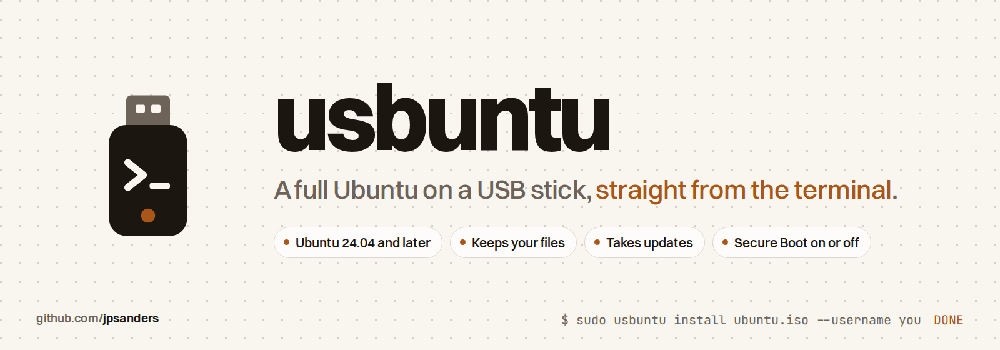

<p align="center">
  <picture>
    <source media="(prefers-color-scheme: dark)" srcset="docs/images/banner-dark.png">
    
  </picture>
</p>

<p align="center">
  <a href="https://github.com/jpsanders/usbuntu/actions/workflows/dev.yml"></a>
  <a href="https://github.com/jpsanders/usbuntu/releases/latest"></a>
  <a href="https://www.python.org/downloads/"></a>
  
  
  <a href="#with-an-ai-agent"></a>
  <a href="https://mypy-lang.org/"></a>
  <a href="LICENSE"></a>
  <a href="https://github.com/jpsanders/usbuntu/stargazers"></a>
</p>

Install a complete, bootable Ubuntu system on a USB stick from an ISO, straight from the terminal.

usbuntu is not `dd`. A raw ISO copy gives you a live session that forgets everything. A normal install needs an
installer boot first. usbuntu skips both: it unpacks the ISO's own system layers straight onto the stick, installs the
bootloader, and hands you a full Ubuntu that keeps its files, takes updates and installs software. A portable machine
in your pocket.

```sh
uv tool install git+https://github.com/jpsanders/usbuntu@1.2.0
usbuntu devices
sudo usbuntu install ubuntu-26.04.1-desktop-amd64.iso --username you
```

Type `WIPE` at the prompt, wait about twenty minutes, reboot, press F12 and pick the stick.

## Install

It needs Python 3.14 or later on any Linux machine that can mount things; Ubuntu, Debian and friends work out of the
box, and uv fetches a Python if yours is older.

```sh
uv tool install git+https://github.com/jpsanders/usbuntu@1.2.0
```

`pipx install git+https://github.com/jpsanders/usbuntu@1.2.0` works too.

## Use

```sh
usbuntu devices                                                   # which disks are safe targets, no root needed
sudo usbuntu install ubuntu.iso --username you --dry-run          # show the plan, touch nothing
sudo usbuntu install ubuntu.iso --username you                    # everything else optional
sudo usbuntu inspect ubuntu.iso                                   # which layers an ISO would install
sudo usbuntu verify /dev/sda                                      # check a stick's boot chain
```

Every variable:

| Variable | Flag | Default |
| --- | --- | --- |
| Account name | `--username you` | required |
| Starting password | `--password secret` | generated, printed at the end |
| Force a new password at first login | `--no-force-password-change` | forced |
| Machine name | `--hostname my-stick` | `usb-ubuntu` |
| Full or reduced desktop | `--flavor full\|minimal` | `full` |
| Language layers | `--language en` | `en` |
| Snap | `--remove-snap` | kept |
| Extra apt packages | `--packages curl,vim,git` | none |
| Bundled extras | `--with opencode`, `--with claude-code`, `--with build-tools` | none |
| Target disk | `--device /dev/sda` | the one safe disk found |
| Unattended | `--yes` | asks for `WIPE` |

The password is written to the new system through a pipe, never to a file and never to a log, and a fresh install
always asks for its own password at first login.

## Safe by default

usbuntu will not wipe a disk that is not on USB, not removable, smaller than 8 GiB, or that holds the running system,
so a machine that boots from a stick cannot be told to erase itself. With more than one safe disk it refuses to guess.
`usbuntu devices` shows the same verdicts before you start:

```text
$ usbuntu devices
/dev/nvme0n1    953.9 GiB  SAMSUNG MZVL21T0HCLR  refused: not on USB; not removable; holds the running system (/)
/dev/sdb         14.3 GiB  SanDisk Cruzer Blade  ACCEPTED
```

## With an AI agent

usbuntu ships a skill that teaches an agent to drive it safely: never pick the disk silently, leave `WIPE` to you,
never echo a password, read the log after a failure. Install it as a Claude Code plugin:

```text
/plugin install usbuntu --marketplace jpsanders/usbuntu
```

On Claude Code before 2.1.275: `/plugin marketplace add jpsanders/usbuntu`, then `/plugin install usbuntu@usbuntu`.
Other agents read [`skills/usbuntu/SKILL.md`](skills/usbuntu/SKILL.md) as it is. `usbuntu devices --json` gives an
agent the disk verdicts as data, and `usbuntu guide` prints the whole manual.

There is no MCP server, on purpose: erasing a disk as root should stay a decision a person makes at a terminal.

## How it works

Ubuntu desktop ISOs since 24.04 ship as a stack of squashfs overlay layers: a `minimal` base, a `standard` full desktop
layer, thin language layers, and two kinds of layer that must never reach an installed stick. usbuntu mounts the right
chain with overlayfs and copies the merged view over with `rsync -aHAX`, the same path the official installer takes,
minus the installer.

```text
ISO  ->  squashfs layer chain  ->  overlayfs merged view  ->  rsync  ->  stick
                                                          chroot: apt, account, GRUB
                                                          ESP: signed shim + signed GRUB, md5 verified
```

Every step in that pipeline exists because its absence broke a real install:

1. **Layer selection.** The `live` layer only belongs to the live session. The `enhanced-secureboot` layers whiteout
   the deb kernel from `/boot`, because Ubuntu 26.04 can hand the boot chain to snapd (`boot-managed-by-snapd`).
   usbuntu keeps the classic GRUB path and always excludes both.
2. **overlayfs, not unsquashfs.** Extracting stacked layers one by one with unsquashfs dies on hardlinks across
   layers. Overlayfs consumes whiteouts correctly and rsync preserves what it merges.
3. **A truthful `/etc/mtab`.** Chrooted GRUB tools read the host's mount table and probe the wrong root. usbuntu writes
   a real `mtab` naming the stick before `update-grub` runs.
4. **The signed binaries, verified.** `grub-install` in a chroot can silently write its own unsigned GRUB image to
   `EFI/BOOT/BOOTX64.EFI`, which boots to a bare `grub>` prompt. After every install usbuntu copies the genuine signed
   shim and GRUB from the target's own packages and verifies them with md5. `sudo usbuntu verify /dev/sda` runs the
   same checks again on any stick, any time.

## Notes

- The stick must be at least 8 GiB and the machine must boot with UEFI. The result boots with Secure Boot on or off,
  because the chain is the same signed shim Ubuntu ships.
- `--remove-snap` purges snapd and holds it back. Firefox and the Snap Store go with it; install a deb browser in
  `--packages` if you want one.
- A failed run costs little: the completed system copy is marked on the stick and the next run resumes from it instead
  of copying 7 GB again. Stop the desktop's automount monitor and unmount the leftovers first; `usbuntu guide` has the
  exact commands.
- Every root run appends a log to `/var/log/usbuntu.log`: the commands, the phase messages, the full traceback, and,
  when the chroot fails, the real `apt` error. Diagnose from there instead of exit codes.
- The pipeline was verified end to end against the 26.04.1 desktop ISO on a 16 GiB SanDisk Cruzer Blade.

## The manual

`usbuntu guide` prints the full manual for people and agents, `usbuntu man` shows it as a man page, and
`usbuntu man --install` makes `man usbuntu` work. The source is [`docs/MANUAL.md`](docs/MANUAL.md).

## Develop

```sh
make init-dev
make checks
```

`make checks` runs isort, black, editorconfig-checker, darglint, flake8, mypy in strict mode, bandit, the man page
check and pytest with coverage, the same as CI. Tests never touch a real disk. See [CONTRIBUTING.md](CONTRIBUTING.md)
and [AGENTS.md](AGENTS.md).

## Star history

<a href="https://star-history.com/#jpsanders/usbuntu&Date">
  <picture>
    <source media="(prefers-color-scheme: dark)" srcset="https://api.star-history.com/svg?repos=jpsanders/usbuntu&type=Date&theme=dark">
    
  </picture>
</a>

## Licence

MIT. Made by [James Phillip Sanders](https://jamesphillipsanders.com).
